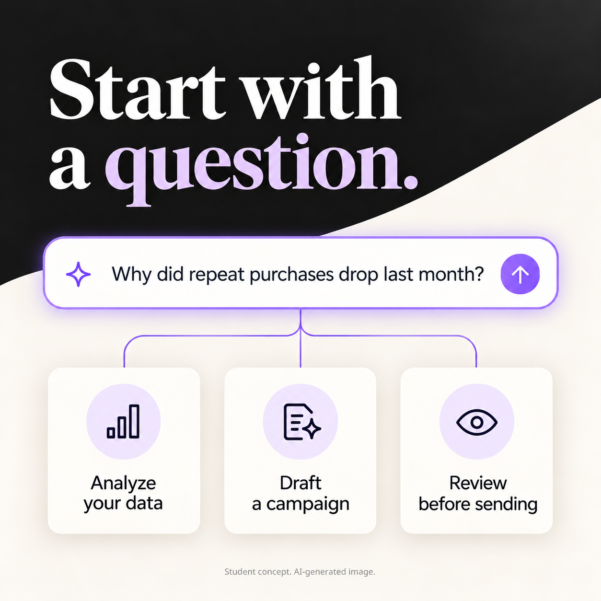

# Chapter 3: Campaign + Critique

**Student work for MKTG 579 at UW Foster. Created for a class. Not affiliated with or endorsed by Klaviyo.**

**Company:** Klaviyo  
**Moment:** Composer’s availability to Klaviyo customers, the announcement used in my October 25 campaign.  
**Author:** Tejash Bagri

[Brand guide](#brand-guide)

## Campaign idea

Start with a question a marketer needs to answer. Show how customer data can inform a campaign draft, with the marketer reviewing the work before it goes live. The customer email explains a use inside Klaviyo. The prospect ad introduces the value through a repeat-purchase question.

## Social caption

Composer is available to every Klaviyo customer. Start with a question your team needs to answer, such as “Why did repeat purchases drop last month?” Use Composer to analyze your Klaviyo data, identify what needs attention and prepare a campaign draft. Review the work before it goes live. Open Composer and try a specific question from your own business this week.

## Customer email

**Subject:** Start your next review with one question  
**Preheader:** Use Composer to analyze your Klaviyo data and prepare work for review.

Your Monday performance review can start with a question.

“Why did repeat purchases drop last month?”

Composer is available to every Klaviyo customer. Ask it to analyze your data, audit a campaign or prepare a draft from a goal in plain language. Use the answer to decide what deserves a closer look before you plan the next campaign.

You can also schedule recurring analysis and save repeatable processes as Skills. Your team reviews customer-facing work before it goes live.

Open Composer and start with a question from this week’s review.

**CTA:** [Explore Composer](https://www.klaviyo.com/blog/composer-marketing-agent)

## Paid social ad

**Audience:** B2C marketers evaluating customer-data and marketing tools.

**Primary text:** Why did repeat purchases drop last month? Explore your customer data with Klaviyo Composer, then prepare a campaign draft your team can review. See how Composer fits your marketing work.

**Headline:** Explore the question behind repeat purchases  
**Description:** Customer data to campaign draft  
**Button:** [Learn More](https://www.klaviyo.com/blog/composer-marketing-agent)

## Campaign image

This image accompanies the paid social ad. It illustrates a concept workflow and does not represent a product screenshot or a reported customer result.

*Student work for MKTG 579 at UW Foster. Created for a class. Not affiliated with or endorsed by Klaviyo. AI-generated image.*

## The catch in the first draft

The original AI draft, preserved in my campaign document:

> Composer is now live for every Klaviyo customer. Ask one question and it can find the opportunity, build the campaign, and launch it across channels for you.

“Launch it across channels for you” overstates the product. Box 5 of my brand guide rules out automatic publishing or sending of all customer-facing work. The Help Center describes review and approval before customer-facing work goes live. I changed the claim to preparing a draft for review and added that limit to the subsequent prompts.

The replacement in the campaign document:

> Composer is now live for every Klaviyo customer. Ask one question and it can surface the opportunity, build the campaign draft, and hand it back for review before anything goes live.

The final pieces above retain that review requirement. This is a factual correction tied to a brand rule, rather than a cosmetic shortening.

## Response to the peer feedback

A classmate reviewed my [October 25 discussion post](https://canvas.uw.edu/courses/1932779/discussion_topics/10818942). His main concern was persuasion: the prospect ad sounded like an announcement for existing users. He also noted that the campaign asked people to start with a question without giving them one.

I revised the prospect ad to open with “Why did repeat purchases drop last month?” The same question appears in the email and image. It gives the viewer a concrete task to imagine. I reduced the approval language to one review clause, while keeping the boundary in Box 5.

I replaced the dense image with one question and three workflow labels. This removes the unsupported “SMS” and “Workflow” labels and makes the concept easier to scan on a phone. The original image used the same visual palette, but its headline and detailed interface pulled attention away from the question.

I did not add the customer-count statistic to the ad. The question and use case do more work for this version, and the ad stays focused. I would check the current count before using a numerical claim in a live campaign.

## Peer critique completed

I posted my review of a classmate’s Warby Parker campaign in Canvas on October 25 at 11:17 a.m. It checks pricing against the brand guide, the caption’s voice, urgency language, image design and the corrected AI pricing claim. The existing review remains in the class discussion.

## Evaluation plan

The campaign has not run, so these are proposed checks and measures.

- **Truth:** Functional claims map to Box 4. No guaranteed lift or automatic-publishing claim appears.
- **Voice:** The pieces lead with an update or a concrete task, using the practical language in Box 3.
- **Brand behavior:** No discount, fake scarcity or unsupported superlative appears, consistent with Boxes 5 and 6.
- **Image:** No faces, customer logos, reported results or performance guarantees appear. The concept follows the palette in Box 7.
- **Customer adoption:** Track Composer opened, first task completed and repeat weekly use. These address adoption beyond clicks.
- **Prospect response:** Track visits and qualified product interest. Attribute any business result through a suitable test rather than assuming the ad caused it.

## Brand guide

The guide below is the one used for the original campaign. Its public-source observations are working guidelines, rather than an internal Klaviyo brand book.

Klaviyo Brand Guide

Company: Klaviyo

Moment: Composer, Klaviyo’s AI marketing agent, is available to every Klaviyo customer.

Student work for MKTG 579 at UW Foster. Created for a class. Not affiliated with or endorsed by Klaviyo.

Built from: Klaviyo’s public site, Composer pages, five recent public social posts, and two public marketing emails. Box 4 uses public Klaviyo claims; unsupported claims sit in Box 5.

### Box 1: Who They Are

Klaviyo is the AI-first CRM built for B2C brands. It combines customer data, marketing automation, analytics, and service in one platform.Its current positioning centers on using real-time customer data and AI to build stronger customer relationships and growth.

### Box 2: Who They Are Talking To

B2C marketers, CRM and lifecycle teams, ecommerce operators, and consumer brands that need to turn customer data into campaigns, service, and measurable growth.

### Box 3: How They Sound

Direct. Practical. Energetic.

They do:
- Lead with the announcement, task, or outcome.
- Use short lines, active verbs, numbers, and specific examples.
- Use light social energy when appropriate.

They don’t:
- Spend long paragraphs setting up the point.
- Explain AI only with abstract language.
- Make unsupported superlatives or performance promises.

### Box 4: Facts They Are Allowed To Claim

1. Klaviyo is an AI-first / autonomous B2C CRM.
2. 205,000+ brands use Klaviyo.
3. Composer is Klaviyo’s AI marketing agent.
4. Composer is available to every Klaviyo customer.
5. Composer can analyze Klaviyo data and provide grounded answers.
6. Composer can audit marketing work and prepare campaign, flow, segment, and message drafts for review.
7. Composer can run recurring or scheduled tasks.
8. Skills let teams save repeatable processes.

### Box 5: Things They Are Not Allowed To Claim

- Composer guarantees revenue growth, conversion lift, or perfect accuracy.
- Composer automatically publishes or sends all customer-facing work.
- Composer replaces marketer judgment or removes review.
- Every recommendation is automatically applied.

### Box 6: Things This Brand Never Does

Working rules from the reviewed material:
- Does not tell customers to skip review of customer-facing AI output.
- Does not use fake scarcity or countdown language in the product-launch material reviewed.
- Does not explain a product only through technical AI terminology; the task and outcome come first.

### Box 7: Pictures

High-contrast black, white, and warm cream with restrained purple accents. Large serif headlines sit beside clean sans-serif product UI. Visuals focus on dashboards, campaign builders, data panels, and prompt interfaces. The look is editorial, minimal, and product-led.

Sources and sample notes

Home: https://www.klaviyo.com/ — Autonomous B2C CRM positioning, Composer placement, 205,000+ brands.

About: https://www.klaviyo.com/about — AI-first B2C CRM positioning and customer count.

Composer launch: https://www.klaviyo.com/blog/composer-marketing-agent — General availability, grounded analysis, recurring tasks, Skills.

Composer Help Center: https://help.klaviyo.com/hc/en-us/articles/52308768755739 — Analyze/audit/create capabilities and review requirements.

Klaviyo LinkedIn release post: https://www.linkedin.com/posts/klaviyo_we-just-launched-three-new-ways-to-capture-activity-7478100459770175489-75UP — Direct launch hook and concrete use cases.

Klaviyo LinkedIn Vibe Marketing post: https://www.linkedin.com/posts/klaviyo_were-officially-in-our-vibe-marketing-era-activity-7442994832488173568-vd-i — Playful social language and concise CTA.

Klaviyo LinkedIn acquisition post: https://www.linkedin.com/posts/klaviyo_big-news-weve-acquired-agency-an-ai-native-activity-7492974383158923265-S4Cv — Announcement-first structure.

Klaviyo LinkedIn company feed: https://www.linkedin.com/company/klaviyo — Current short hooks, product updates, and numbers.

Klaviyo Partners post: https://www.linkedin.com/posts/klaviyo-partner_whats-new-at-klaviyo-activity-7503516985910243330-mI4k — Composer claims plus explicit review-before-live language.

Milled: Find the gaps costing you revenue: https://milled.com/klaviyo.com/webinar-find-the-gaps-costing-you-revenue-OtKUnOeKjq_vtr7_ — Action-led subject and practical Composer use case.

Milled: Humantra grew to 30,000 subscribers: https://milled.com/klaviyo.com/how-humantra-grew-to-30-000-subscribers-in-just-12-months-KV-vuXeX6pv2OcJ3 — Outcome-led subject, short sections, direct CTAs.

Sample limits: The social and email voice is based on public material, not an internal Klaviyo brand book. Box 6 is a working rule set derived from the reviewed samples.

## Prompt record

The following is the prompt record preserved in the original campaign document. It uses `[BRAND GUIDE]` to mark the full guide that the document says was pasted during generation. That placeholder is part of the retained record. I have included the full guide above so the context can be inspected. I have not represented a reconstructed prompt as a verbatim historical transcript.

Original saved prompts

Every prompt below included the full brand guide at [BRAND GUIDE]. The guide was pasted in full during generation; it is not repeated four times here.

Caption prompt

Context: I’m writing launch content for Klaviyo. Composer, Klaviyo’s AI marketing agent, is available to every Klaviyo customer. It can analyze Klaviyo data, surface priorities, audit marketing work, draft campaigns/flows/segments/messages for review, run recurring tasks, and use Skills for repeatable team processes. The audience is B2C marketers and CRM/lifecycle teams. My brand guide is below and is the source of truth. [BRAND GUIDE]Role: You are a social copywriter on Klaviyo’s in-house marketing team.Ask: Write a LinkedIn caption announcing Composer’s general availability.Format: 3 options, each 60–90 words. Maximum four short paragraphs. No hashtags.Tone and limits: Direct, practical, energetic. Lead with the product update, then specific uses. Do not claim Composer publishes or sends customer-facing campaigns automatically. Do not promise guaranteed revenue or accuracy. Do not say Composer replaces marketers. If a needed fact is not in the guide, write [NEED FACT]. After each option, list the Box 4 fact supporting every factual claim.

Email prompt

Context: I’m writing launch content for Klaviyo. Composer, Klaviyo’s AI marketing agent, is available to every Klaviyo customer. It can analyze Klaviyo data, surface priorities, audit marketing work, draft campaigns/flows/segments/messages for review, run recurring tasks, and use Skills for repeatable team processes. This email goes to existing Klaviyo customers. My brand guide is below and is the source of truth. [BRAND GUIDE]Role: You are a lifecycle email writer on Klaviyo’s marketing team.Ask: Write one launch email for Composer’s general availability.Format: Subject under 8 words. Preheader under 18 words. Body 90–130 words. One CTA.Tone and limits: Direct, useful, product-forward. Give specific examples of what a marketer can ask Composer to do. Do not claim autonomous publishing. Do not promise a revenue result. If a required fact is not supported by the guide, write [NEED FACT]. Then list the Box 4 line behind each factual claim or write NOT IN GUIDE.

Paid ad prompt

Context: I’m writing a paid-social launch ad for Klaviyo Composer. Composer is Klaviyo’s AI marketing agent and is available to every Klaviyo customer. It analyzes Klaviyo data, identifies opportunities, audits marketing work, and prepares drafts for review. The audience is B2C marketing and CRM teams. The ad runs with an AI-generated product-interface image. [BRAND GUIDE]Role: You are a performance copywriter on Klaviyo’s growth team.Ask: Write one paid-social ad for Composer.Format: Primary text under 45 words. Headline under 8 words. Description under 8 words. Choose one CTA from Learn More, Get Started, or Sign Up.Tone and limits: Short, concrete, confident. No “revolutionize,” “game-changing,” “future of marketing,” guaranteed results, fake urgency, or unsupported superlatives. Do not say Composer launches customer-facing campaigns without review. If a fact is missing, write [NEED FACT].

Image prompt

Context: Klaviyo is promoting Composer, its AI marketing agent, now available to every Klaviyo customer. The image will run with a paid-social ad. My brand guide is below. Follow Box 7 for the visual system and Boxes 5 and 6 for claims and behavior. [BRAND GUIDE]Role: You are an art director on Klaviyo’s in-house brand team.Ask: Create one square product-marketing image showing an abstract AI marketing workspace centered on a prompt interface, surrounded by connected panels for understanding data, analyzing performance, creating a campaign, and refining the work.Format: Square social image. One scene. No person, no identifiable face, no photorealistic human. Keep interface copy short and readable.Tone and limits: High contrast, editorial, modern, product-led. Black, cream, white, with restrained purple accents. No fake awards, customer logos, testimonials, performance metrics, or unsupported claims. Do not add any factual text that is not in Box 4.

## Revision instructions

For the copy revision in this chapter, the AI assistant used the company guide, the original campaign and the classmate’s feedback. The revision brief was to open with a concrete repeat-purchase question, distinguish the prospect ad from the customer email, keep one review requirement, preserve supported capability claims and avoid contrasting punchlines. The final copy appears above.

The image edit used OpenAI’s built-in image-generation tool with the original campaign image as the edit target. Its exact prompt is in [Image revision prompt](image-revision-prompt.txt). The edit retained the palette and typography, replaced the headline with “Start with a question.” and removed the small interface lists.

## AI use

- **Tools:** The original campaign records ChatGPT, public web research and OpenAI image generation. This revision used Codex for the writing and the built-in OpenAI image-generation tool for one image edit.
- **Iterations:** The original campaign document records four major writing passes. This update adds one focused copy revision and one image-generation edit.
- **Human review and override in the original work:** The campaign document identifies the automatic-launch claim as the point the author overruled, citing Box 5 and product documentation. This update retains that correction.
- **Useful AI contribution:** Adapting one supported use case across a caption, customer email, prospect ad and visual.
- **AI limitation:** Fluent copy can turn a drafting capability into an unsupported execution claim. The first image also included too much interface detail and labels beyond the guide.
- **Evidence limits:** No live product test, campaign performance result or customer-demand validation is claimed here. The source claims and review record come from the original campaign materials and the visible class discussion.

[Chapter 1](README.md) · [Original campaign discussion](https://canvas.uw.edu/courses/1932779/discussion_topics/10818942)
